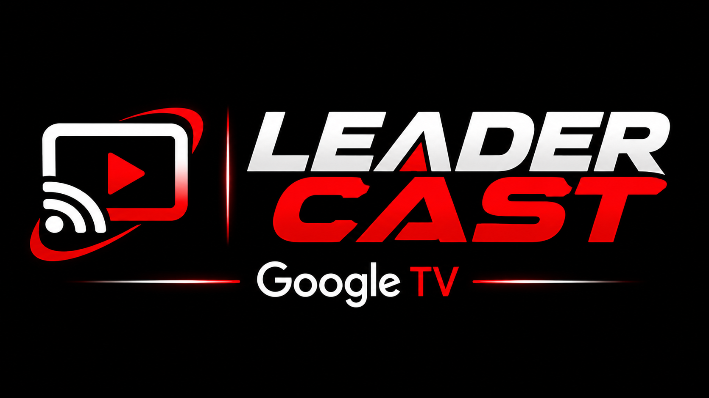
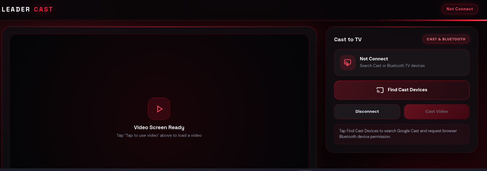

<div align="center">
  
</div>


# LEADER CAST

Unlock the full potential of music: Stream effortlessly with one app!

[](https://github.com/gokadzev/Musify/stargazers)
[](https://github.com/gokadzev/Musify/fork)
[](https://github.com/gokadzev/Musify/releases)
[](https://github.com/gokadzev/Musify/releases)
[](LICENSE)

---

<a href="https://github.com/Leader-Ofc-Dev/" target="_blank" title="ko-fi">
  
</a>


---

## Features

<center>

Online Host videos <br/>
Offline playback support <br/>
Import & export your data and never lose it <br/>
Optional local-network sync between your devices <br/>
Add custom playlists with link <br/>
Listening Recaps <br/>
File import <br/>
Optimized sound experience <br/>
No ads <br/>
No subscriptions <br/>
Built-in updater <br/>
21 supported languages <br/>
Material UI & accent colors & dynamic colors (Android 12+) <br/>

</center>


---

## Screenshots

|  
|----------------------------------------------------------------------------------------------------------------------------------------|

---

## Supported platforms

| Platform | Status |
|----------|--------|
| Android  | ✅ Supported |
| Linux    | ✅  Supported |
| Windows    | ✅  Supported |
| IOS    | ❌ Unsupported |

---

## Download


Android Apk will develop...

---

## Contributors

Special thanks to all contributors for their time and effort.

<a href="https://github.com/Leader-Ofc-Dev/Leader-Cast-Tv/graphs/contributors">
  
</a>


---

## F.A.Q

You can see frequently asked questions and their answers [here](https://github.com/Leader-Ofc-Dev/Leader-Cast-Tv/).

---

## Credits

[Leader Cast Tv](https://github.com/Leader-Ofc-Dev/Leader-Cast-Tv/) - Original inspiration for the concept and name. It is now completely reimplemented with new design and branding.


---

## License

```
Copyright © 2026 LeaderDev

LeaderCast is free software licensed under GPL v3.0. You may use, modify, and distribute
this software freely, but must keep the source code open and publicly available, retain
all copyright notices, disclose all changes made, and use the same GPL v3.0 license.

Prohibited: Closed-source distributions or commercial redistribution of modified versions.
```

See the [GNU General Public License](https://github.com/Leader-Ofc-Dev/Leader-Cast-Tv/) for full details.

---

## Disclaimer

```
LeaderCast and its contributors do not host, own, or distribute any copyrighted audio content.
The app provides access to content through plugins and external sources. All trademarks, songs, audio files, and related content remain the property of their respective owners and are protected by applicable copyright laws.
Included plugins are provided for interoperability and educational purposes only. Users are solely responsible for ensuring that their use of the app complies with local laws, copyright regulations, and the terms of service of the respective content providers.
The developers of LeaderCast do not encourage or endorse copyright infringement and assume no liability for misuse of the software or third-party plugins.
```
---
